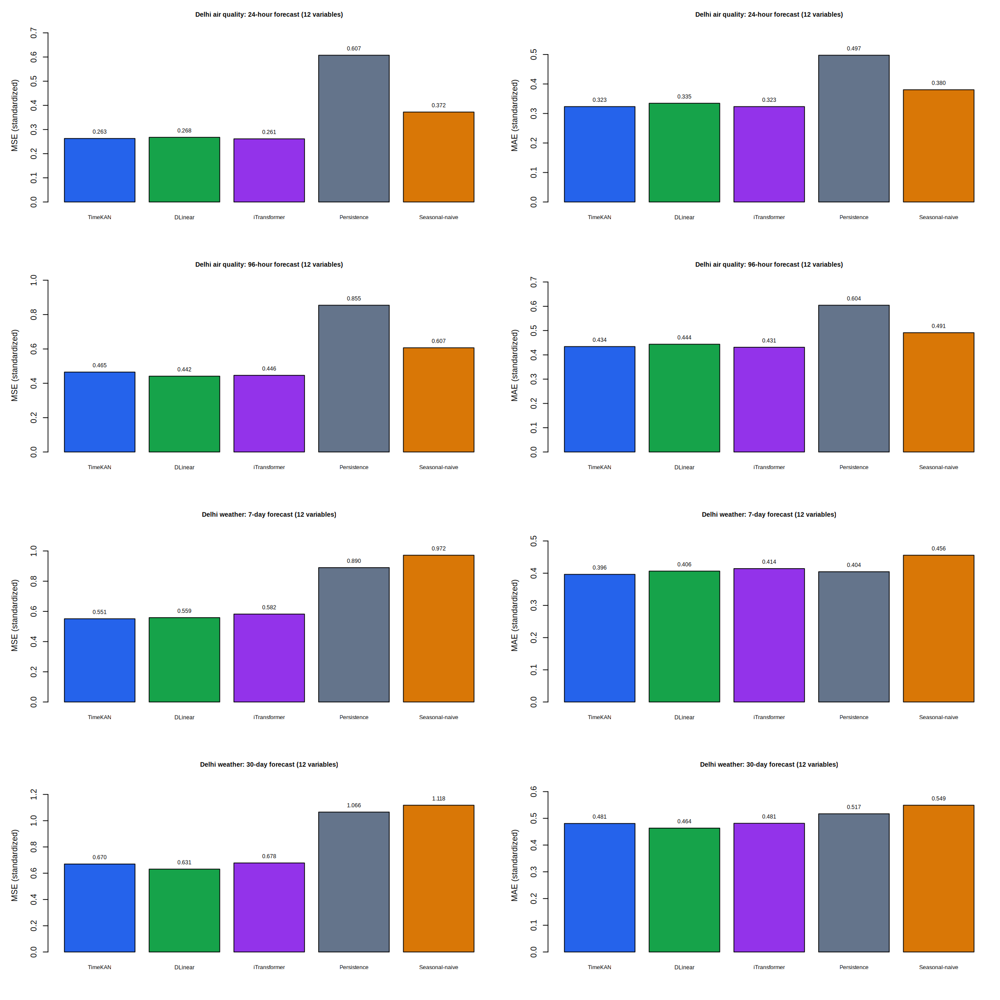

# Indian dataset experiments

Completed multivariate forecasting experiments on Delhi air quality and Delhi
daily weather: **12 variables per dataset, four forecast cases, 12 trained runs**
(four TimeKAN, four DLinear, four iTransformer), and **five selected PNG figures**.

## Results

Standardized test MSE (lower is better):

| Dataset / horizon | TimeKAN | DLinear | iTransformer | Persistence | Seasonal-naive |
|---|---:|---:|---:|---:|---:|
| Air quality: 24 hours | 0.262906 | 0.267708 | 0.261449 | 0.607489 | 0.372338 |
| Air quality: 96 hours | 0.465244 | 0.441549 | 0.446369 | 0.854531 | 0.606645 |
| Weather: 7 days | 0.551218 | 0.558775 | 0.582280 | 0.889890 | 0.972026 |
| Weather: 30 days | 0.670001 | 0.631185 | 0.678130 | 1.065616 | 1.117734 |



TimeKAN is competitive but does not consistently beat the learned baselines.
iTransformer has the lowest MSE on 24-hour air quality, DLinear on 96-hour air
quality and 30-day weather, and TimeKAN on 7-day weather. These rankings concern
MSE; MAE rankings can differ. Single-seed, up-to-10-epoch results do not establish
statistical significance or a general ranking. The iTransformer uses a compact
128-dimensional configuration, not the published benchmark configuration.

## Selected figures

The repository keeps only the overall comparison and one forecast example for
each forecasting case. Each example shows four variables at the first test
origin; the overview scores all 12 variables across all eligible test windows.

| Plot | Link |
|---|---|
| Overall MSE/MAE comparison: all methods and horizons | [Comparison](figures/india/learned_baselines/learned_baseline_comparison.png) |
| Air quality: 24-hour forecast | [Forecast](figures/india/learned_baselines/Delhi_air_multivariate_F24_forecast_comparison_1.png) |
| Air quality: 96-hour forecast | [Forecast](figures/india/learned_baselines/Delhi_air_multivariate_F96_forecast_comparison_1.png) |
| Weather: 7-day forecast | [Forecast](figures/india/learned_baselines/Delhi_climate_multivariate_F7_forecast_comparison_1.png) |
| Weather: 30-day forecast | [Forecast](figures/india/learned_baselines/Delhi_climate_multivariate_F30_forecast_comparison_1.png) |

Detailed diagnostics can be regenerated from the saved records; they are ignored
by Git. Only combined metric tables, compact completion records, and the official
parity-check report are retained. Redundant per-run CSV exports and text copies
of record metadata are omitted.

## Browse the outputs

| Content | Location |
|---|---|
| Five selected comparison/forecast plots | [figures/india/learned_baselines](figures/india/learned_baselines/) |
| Full MSE/MAE comparison | [all_models.csv](results/india/learned_baselines/all_models.csv) |
| Errors for individual variables | [all_models_per_variable.csv](results/india/learned_baselines/all_models_per_variable.csv) |
| Errors by forecast lead | [all_models_by_horizon.csv](results/india/learned_baselines/all_models_by_horizon.csv) |
| TimeKAN metrics, training curves and run records | [results/india/timekan](results/india/timekan/) |
| Learned baseline metrics, curves and run records | [results/india/learned_baselines](results/india/learned_baselines/) |
| Data handling and TimeKAN commands | [INDIA_MULTIVARIATE.md](docs/india/INDIA_MULTIVARIATE.md) |
| Baseline architectures, checks and commands | [LEARNED_BASELINES.md](docs/india/LEARNED_BASELINES.md) |
| Reference sources and licenses | [third_party/india_baselines](third_party/india_baselines/) |

Forecast images show the first eligible test origin; numerical scores use every
eligible observed target across all test windows. Missing targets are masked,
never scored as imputed truth. Means, scales and feature selection use training
observations only. Every model uses identical variables, chronological splits,
history length, target masks and forecast origins. Data hashes, scales, window
counts and recomputed naive errors are checked against frozen TimeKAN records.

## Reproduce or regenerate

The forecasting, training, evaluation and plotting code is native R (`torch` and
`coro`). Keep `timekan.R`, `run_india_multivariate.R` and
`indian_learned_baselines.R` in the repository root. Models/datasets are not
downloaded or retrained merely by opening this report.

Recreate plots from the included lightweight records, without training or torch:

```sh
Rscript run_india_multivariate.R --task plots
Rscript indian_learned_baselines.R --task plots
```

For fresh training, use the raw Kaggle CSVs and the commands in the linked guides.
Use batch size 64 for TimeKAN to match these experiments. Dataset files and `.pt`
model weights stay out of Git; Google Drive retains the complete experiment
backups. The `.rds` files here contain compact metrics/configuration records and
illustrative predictions, not neural model weights.

The optional official Python parity check compares R/Python forecasts and input
gradients. Its one reference-only normalization adjustment is documented in the
baseline guide. The test results and exact upstream blob hashes are included.

Saved notebook with the new cells and outputs:
[TimeKAN_Indian_Baselines_R.ipynb](https://colab.research.google.com/drive/14mxAhdgcqSo3Hm7coNXRI0fJLY8vXpjM).
