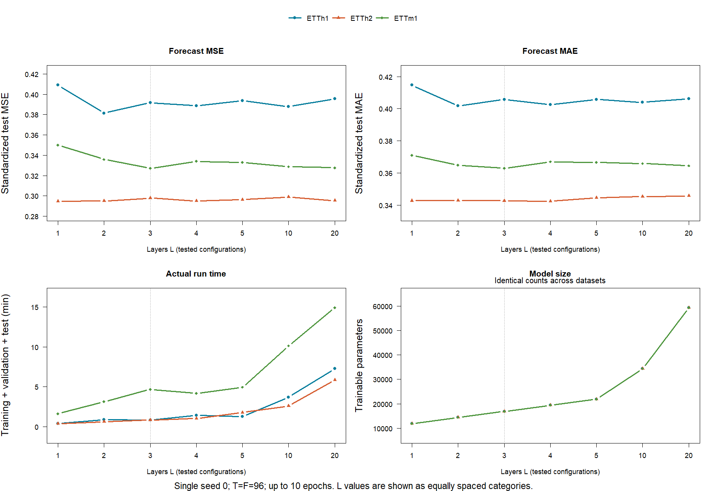
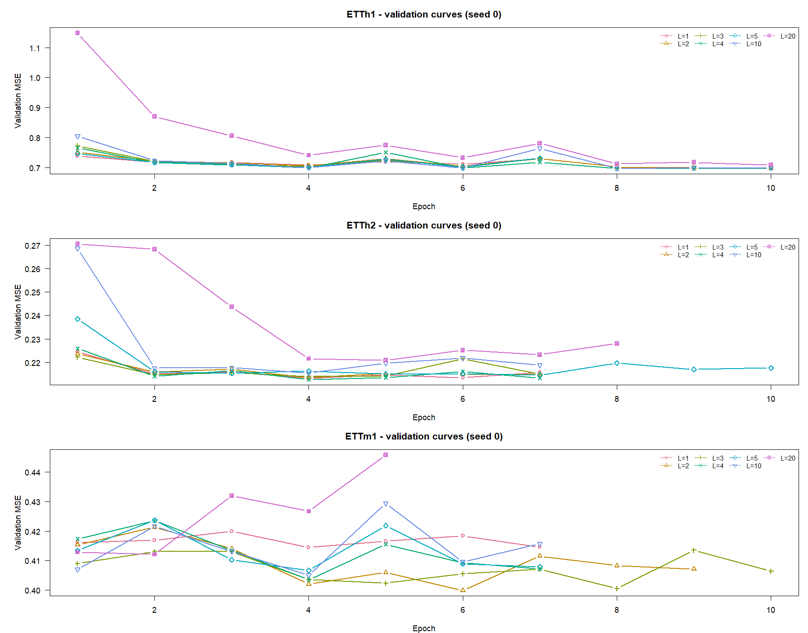

# How many TimeKAN layers are useful?

This is a new **single-seed sensitivity experiment in the project's R implementation**,
not a result reported by the authors and not an exact reproduction of their full
Python configuration. No depth result should be quoted until training completes.

## Fixed protocol

- Datasets: ETTh1, ETTh2 and ETTm1, all seven variables. The first two are the
  smallest ETT benchmarks; ETTm1 adds a 15-minute dataset without the many channels
  of Electricity or Weather. ETTm2 has the same size as ETTm1 and can be substituted.
- Layers **L = 1, 2, 3, 4, 5, 10, 20**; seed **0** only: **21 runs**.
- History 96 and forecast horizon 96 samples (96 hours for ETTh; 24 hours for ETTm).
- Standard ETT chronological 12/4/4-month train/validation/test split; full
  benchmark partitions, no subsampling. Train-only z-score scaling.
- Width 16, three frequency bands, pooling factor 2, Chebyshev orders 3/2/1,
  depthwise convolutions, existing R model's `cfd_mode=paper` and window normalization.
  The newer `exact`/`official` CFD alternatives are not varied in this study.
- Adam 0.001, batch 128, maximum 10 epochs, patience 3 for every depth.
  Initial weights use seed 0; shuffle RNG resets to seed+epoch so model size does
  not change the shuffle stream simply by consuming initialization randomness.
- The lowest validation MSE selects each run's checkpoint. MSE and MAE are
  computed over all seven standardized variables, all 96 forecast leads and all
  eligible rolling test origins. Test errors do not select checkpoints/settings.

## Run

An optional [Colab notebook](../notebooks/TimeKAN_Layer_Depth_Study.ipynb)
sets up R torch, mounts Drive, runs only this study, displays results and creates
a full backup ZIP. Its default GPU check stops if a GPU has not been allocated.

On Kaggle, use a Python notebook with **GPU T4 x2** and **Internet on**, install
the CUDA R torch package, then run `python run_depth_kaggle.py` from the repository
root. The optional launcher assigns independent experiments to the two GPUs;
it does not change any model or training settings. Each R worker writes to its
own job folder, and the launcher consolidates completed records serially.
It updates `TimeKAN_depth_results.zip` after every completed run. The active
project notebook is [TimeKAN Layer Depth Study R](https://www.kaggle.com/code/deb044/timekan-layer-depth-study-r/edit).
Kaggle draft files require persistence or a saved version; retain the results ZIP.

The [Kaggle notebook](../notebooks/TimeKAN_Layer_Depth_Kaggle.ipynb) includes the
setup and complete run. Its helper installs official CUDA R torch 0.17.0 into
`/kaggle/working/R-library` and caches the installer under the working directory,
so reconnecting does not require another full download. The installer cache and
R library are outside the repository and excluded from the experiment ZIP.

Use the repository root, with R `torch` and `coro` installed. GPU setup follows
the [official R torch installation instructions](https://torch.mlverse.org/docs/articles/installation).
Only the three required public ETT CSVs are downloaded automatically if absent.

```sh
Rscript run_depth_experiment.R --task self_test
Rscript run_depth_experiment.R --device cuda
```

On a CPU use `--device cpu --threads 2`. Before a long CPU run measure one full
ETTh1 epoch at L=2, saved in a separate benchmark directory:

```sh
Rscript run_depth_experiment.R --task benchmark --device cpu
```

For Colab, add the R commands to Python cells with a leading `!`. To preserve
results on an already mounted Google Drive:

```sh
Rscript run_depth_experiment.R --device cuda --backup /content/drive/MyDrive/TimeKAN_depth
```

The script resumes completed runs, checks source/data hashes and settings before
reuse, and updates tables/plots and the optional backup after every completed run.
It never imports an older L=2 result from a different experiment. Failures are
reported explicitly; they are not converted into invented error values.
Use a new `--results_dir` and `--figures_dir` when changing training settings.
To include ETTm2 as a fourth dataset use `--datasets ETTh1,ETTh2,ETTm1,ETTm2`.

## Compact outputs

- `results/depth/summary.csv`: one row per run with L, validation MSE, test MSE/MAE,
  parameters, measured runtime, selected epoch and training-limit flags.
- `results/depth/learning_curves.csv`: train/validation MSE and duration per epoch.
- `results/depth/records/`: small RDS records with configuration, hashes, scaling,
  window counts and session information. No model weights are published.
- `figures/depth/depth_accuracy_cost.png`: error, runtime and parameter count vs L.
- `figures/depth/depth_validation_curves.png`: convergence check for each dataset.

Only the two figures and two consolidated tables need to be tracked in Git;
per-run records and temporary benchmark files stay ignored. The optional Drive
backup retains the detailed records. Regenerate figures without torch/training:

```sh
Rscript run_depth_experiment.R --task plots
```

## Interpretation

Report the measured accuracy/cost trade-off. If deeper models do not improve,
the supported conclusion is limited to these datasets, horizon, seed and training
budget. This cannot establish that L=3 is universally optimal or explain the
authors' choice. One seed supplies no estimate of seed-to-seed uncertainty.
`hit_epoch_limit` and `best_in_last_two` flag potentially unfinished convergence;
a worse deep model may need more training or different optimization. The fixed
ten-epoch budget intentionally measures performance under the project deadline.

## Completed results

All **21 runs** completed on Kaggle's two Tesla T4 GPUs, with one independent
native-R training process per GPU. The grid and training settings above were
fixed before the runs. The two figures and two consolidated CSVs are retained
in Git; detailed per-run RDS records remain in the full results ZIP.

**Standardized test MSE / MAE** (lower is better), all seven variables:

| L | ETTh1 MSE / MAE | ETTh2 MSE / MAE | ETTm1 MSE / MAE | Parameters |
|---:|---:|---:|---:|---:|
| 1 | 0.4089 / 0.4147 | 0.2949 / 0.3427 | 0.3500 / 0.3710 | 11,921 |
| 2 | 0.3814 / 0.4018 | 0.2950 / 0.3429 | 0.3359 / 0.3648 | 14,417 |
| 3 | 0.3917 / 0.4058 | 0.2979 / 0.3427 | 0.3272 / 0.3629 | 16,913 |
| 4 | 0.3888 / 0.4026 | 0.2950 / 0.3424 | 0.3340 / 0.3669 | 19,409 |
| 5 | 0.3936 / 0.4058 | 0.2963 / 0.3445 | 0.3330 / 0.3666 | 21,905 |
| 10 | 0.3878 / 0.4040 | 0.2989 / 0.3453 | 0.3288 / 0.3659 | 34,385 |
| 20 | 0.3955 / 0.4061 | 0.2954 / 0.3457 | 0.3277 / 0.3645 | 59,345 |

Full precision, selected epochs and measured times are in
[summary.csv](../results/depth/summary.csv). Training/validation errors and
epoch durations are in [learning_curves.csv](../results/depth/learning_curves.csv).
The [environment record](../results/depth/environment.json) identifies the exact
training sources, settings, hardware and verification checks.



### What the results support

The lowest **observed test MSE** occurred at L=2 on ETTh1, L=1 on ETTh2 and L=3
on ETTm1. This is a descriptive observation, not a rule to select depth using
test data. From L=3 to L=20, test MSE changed by less than 1% on each dataset,
while actual run time increased by approximately 3.2–8.9 times and parameter
count increased from 16,913 to 59,345. The run-time comparison includes different
early-stopping epochs; per-epoch durations are retained in the learning curves.

This supports a favorable accuracy/cost trade-off for shallow models in this
R reproduction under the fixed short budget. It does **not** establish that
L=3 is universally optimal or explain the authors' unreported selection process.
For example, validation-only depth selection would give:

| Dataset | L selected by validation MSE | Test MSE | Test MAE |
|---|---:|---:|---:|
| ETTh1 | 10 | 0.3878 | 0.4040 |
| ETTh2 | 4 | 0.2950 | 0.3424 |
| ETTm1 | 2 | 0.3359 | 0.3648 |

ETTh1's validation scores at L=4 and L=10 are almost tied (0.696542 versus
0.696516), illustrating why small single-seed differences should not be overstated.
ETTh1 at L=2 and L=20 selected their final allowed epoch; longer training could
change those comparisons. Several other runs also reached the ten-epoch cap.
There are no seed-variation error bars or significance claims.



### Reproduce the presentation plots and checks

The training runner retains its original diagnostic plotting code. The separate
presentation renderer uses the same saved numbers, explicitly labels every tested
L, and places the dataset legend outside the data. The L axis uses equally spaced
categories because the tested grid is not uniformly spaced numerically.

```sh
Rscript scripts/depth/plot_results.R
```

This command needs only base R and the two public CSVs; it performs no training.
To audit the full results ZIP after extraction (including the archived RDS records
and exact training source snapshots):

```sh
Rscript tests/depth/check_results.R /path/to/extracted/archive
```

The audit checks the full grid, fixed settings, ETT window counts, checkpoint
selection, stopping flags, parameter counts, numerical summaries and source hashes.
